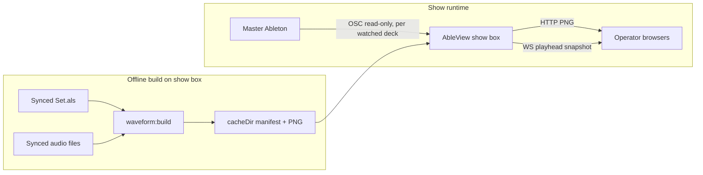

# M9 — Waveform + playhead

Build plan for offline waveform assets and realtime playheads in operator views. Implements spec
§11 extension point (“waveform + playhead”); does **not** change NFR-1 (read-only Ableton).

**Resolved structure:** this rig uses **`bestMatch` across `ingest.watchedTracks`** (the
configured decks). A single designated cue track is **not** the source for waveforms. Spec §11
and early drafts of this plan assumed one cue-track clip; that assumption is withdrawn here.

**Agent workflow:** one sub-milestone (M9a–M9d) per session/commit. Run `npm test` after each
stage. Prototype with `npm run sim` before Live validation.

**Related:** [`ableview_spec_from_claude.md`](../../ableview_spec_from_claude.md) §11,
[`ROADMAP.md`](../../ROADMAP.md), [`AGENTS.md`](../../AGENTS.md).

---

## 1. Goal and non-goals

### Goal

- Prebuild a **static waveform image** for each audio clip on the watched decks.
- Stream a **realtime playhead** per watched deck from read-only AbletonOSC.
- **Matched** operator view (`match.matched === true`, including a pin): show **one** strip,
  the clip that won the match (`trackMatches[].winner === true`, same clip as `CuePayload.clipName`).
  The other decks stay hidden, same as their names already are.
- **Unmatched** operator view (no confident match, playing-clip chips visible): show **every**
  playing watched deck’s waveform and playhead **inside that deck’s chip**, with the deck name
  and clip title that chip already shows.
- **Offline build** on the **show box**, from the synced Live project folder (`.als` + audio).
  The Ableton laptop keeps running Live + AbletonOSC only. No AbleView install and no build
  step on that machine.
- **Show runtime:** on clip change, load pre-built assets; playhead updates do not rematch.
  No audio decode on the hot path when the cache is warm.

### Non-goals

- Reading waveform samples out of a running Ableton session at show time.
- Any write OSC to Ableton (tempo, fire clip, seek, etc.) — NFR-1 permanent. The playhead is
  not a scrubber.
- A designated cue track, or `waveform.cueTrack`, as the clip source.
- One mixed waveform of all decks at once.
- Replacing TouchDesigner / tdableton for the visuals op.
- Arrangement view as a cue source. Leftover arrangement clips stay match-excluded under
  `match.includeArrangement` (default off) and do not become the matched strip.
- Sample-accurate warp/loop visualization (v1 uses file duration + the position Live reports).
- Waves on Session, Set, Breath, or the admin dashboard. Those views stay as they are.

---

## 2. Architecture

```
  OFFLINE (show box, after the set is saved and the project sync has landed)
  ─────────────────────────────────────────────────────────────────────────
  Synced Set.als (gzip XML) + projectRoot on the show box
        → parse session clips on ingest.watchedTracks (name + FileRef)
        → resolve audio paths on disk
        → generate PNG (+ meta.json) per clip
        → write manifest.json under waveform.cacheDir

  RUNTIME (show night)
  ───────────────────
  Master Ableton + AbletonOSC          AbleView on the show box
        → read-only OSC: slot, name, playing_position, length
          for each watched deck’s current slot
        → matcher → CuePayload (unchanged cadence; picks one winner)
        → separate playhead snapshot (all watched decks, high rate, no rematch)
        → browsers:
             matched    → one PNG + playhead (the winner)
             unmatched  → one PNG + playhead per playing-clip chip
```



The Ableton laptop is not a build machine. `ingest.abletonHost` still points at that
laptop. `waveform.alsPath` and `waveform.projectRoot` point at the **show box’s copy** of
the project (Dropbox or whatever sync already carries the set).

---

## 3. Open decisions (defaults for implementation)

Display source and match behavior below are **resolved**. Do not reintroduce a cue track.

| ID | Topic | Decision |
|---|---|---|
| OD-W1 | Which views | Operator views that share the cue layout: **`band`**, **`lighting`**, **`visuals`**. Opt out with `waveformPanel: false`. Session, Set, Breath, and admin do not mount the panel in v1. |
| OD-W2 | Cache artifact format | **PNG** + **`meta.json`** per clip (`durationSeconds`, `sourcePath`, `builtAt`); aggregate **`manifest.json`**. One asset is scaled into both the full-width matched strip and the narrower unmatched chip. |
| OD-W3 | Manifest lookup key | **Normalized clip name** (matcher rules: lowercase, strip punctuation/version tags). Same name on two decks shares one PNG; positions still differ per deck. Build **warns** when two different files normalize to the same key (last-write-wins). |
| OD-W4 | Build tool for PNG | Optional **`ffmpeg`** on the **show box** for MP3/AIF. **WAV** decodes in-process with no ffmpeg. Clear error for other formats when ffmpeg is absent. |
| OD-W5 | `.als` input | Show-box `config.json`: `waveform.alsPath` + `waveform.projectRoot`. CLI flags override. Tracks come from **`ingest.watchedTracks`**, not a separate list. |
| OD-W6 | Playhead on WS | One throttled message, `type: "playhead"`, carrying **every** watched deck. Do not attach it to `CuePayload` and do not rematch. |
| OD-W7 | OSC `file_path` at runtime | Optional sanity check only. File map comes from the offline build. |
| OD-W8 | Matched vs unmatched | **Matched:** winner only, one strip under the song-title hero. **Unmatched:** all playing watched decks, inside the existing playing-clip chips. |

---

## 4. Data contracts

### 4.1 Manifest (`manifest.json` in `waveform.cacheDir`)

```json
{
  "builtAt": "2026-07-27T12:00:00.000Z",
  "alsPath": "C:/Show/MySet.als",
  "projectRoot": "C:/Show",
  "watchedTracks": ["DECK A", "DECK B", "DECK C", "DECK D", "DECK E", "DECK F"],
  "clips": [
    {
      "clipKey": "song-a-intro",
      "clipName": "Song A - Intro",
      "trackName": "DECK A",
      "trackIndex": 2,
      "slotIndex": 0,
      "imagePath": "clips/song-a-intro.png",
      "metaPath": "clips/song-a-intro.meta.json",
      "durationSeconds": 42.5,
      "sourcePath": "C:/Show/Samples/intro.wav"
    }
  ]
}
```

- `clipKey`: filesystem-safe slug from the normalized clip name. Stable across rebuilds while
  the name is unchanged.
- `imagePath` / `metaPath`: relative to `cacheDir`.
- `watchedTracks`: the names the build actually parsed. A drift from `ingest.watchedTracks`
  is an admin warning, not a hot-path failure.

### 4.2 Per-clip meta (`*.meta.json`)

```json
{
  "clipName": "Song A - Intro",
  "durationSeconds": 42.5,
  "sourcePath": "C:/Show/Samples/intro.wav",
  "sourceMtimeMs": 1710000000000,
  "builtAt": "2026-07-27T12:00:00.000Z"
}
```

### 4.3 What the view joins on

No new match fields. The existing `CuePayload` already decides the layout:

- `match.matched === true` → one strip. Clip identity is the `trackMatches` entry with
  `winner: true` (`trackIndex` + `clipName`). That is the same clip as `payload.clipName`.
- `match.matched !== true` and the Current pane is showing playing-clip chips → one wave per
  chip, joined on `trackIndex`.
- A **pin** (`match.viaOverride === true`) uses the matched layout: still one strip. Follow
  `payload.clipName` when a `winner` entry is absent (pin can replace the row without
  inventing a new winner). If that clip is no longer playing, the strip shows
  `waveformStatus: "none"` rather than falling open into all six.
- The **Last** unmatched pane shows the previous cue’s fields and does **not** show chip
  waves. Waves come back when the operator is on Current.

### 4.4 WebSocket: `playhead` snapshot (server → views)

One message for all watched decks, throttled (about 15–30 Hz) or on meaningful change.
The client interpolates each playhead with rAF. Playhead fraction is
`positionSeconds / durationSeconds`, so the same PNG scales to a full-width strip or a chip.

```json
{
  "type": "playhead",
  "at": "2026-07-27T12:00:01.000Z",
  "decks": [
    {
      "trackIndex": 2,
      "trackName": "DECK A",
      "slotIndex": 0,
      "clipName": "Song A - Intro",
      "clipKey": "song-a-intro",
      "positionSeconds": 12.34,
      "durationSeconds": 42.5,
      "waveformStatus": "ready"
    }
  ]
}
```

`waveformStatus`: `"ready" | "missing" | "midi" | "none"`.

- `ready` — manifest hit, PNG available.
- `missing` — audio clip name with no manifest entry (set not rebuilt, or sync not landed).
- `midi` — clip has no audio file.
- `none` — deck slot empty, or no clip to attach in the matched strip.

Initial view `init` may include `waveformEnabled` and the latest snapshot.

### 4.5 Bus

- Keep `EVENTS.NOW_PLAYING` / `EVENTS.CUE_PAYLOAD` as today.
- Add `EVENTS.PLAYHEAD` subscribed only by the server broadcast layer — **not** by the matcher.
- Ingest coalesces per-deck position replies into **one** snapshot emit. A position packet
  does not log, match, or touch sheets (NFR-4).

---

## 5. Configuration

Add to `config/config.example.json` when implementing M9a (documented here first):

```json
{
  "waveform": {
    "enabled": false,
    "cacheDir": "./data/waveform-cache",
    "projectRoot": "C:/Show",
    "alsPath": "C:/Show/MySet.als",
    "pngWidth": 2560,
    "pngHeight": 72
  }
}
```

- Paths are on the **show box**. `projectRoot` / `alsPath` are the synced project folder.
  `cacheDir` stays under the AbleView data directory.
- There is no `cueTrack` key. The build reads `ingest.watchedTracks`.
- `pngWidth: 2560` matches the Corsair Xeneon Edge width so the matched strip is not an
  upscale. Chips scale the same PNG down. `pngHeight` is the matched strip; chips use a
  shorter band of the same image (about 48–64 px).
- `enabled: false`: no playhead OSC listeners, no HTTP waveform routes, views unchanged.

Per-view (M9d). Default **on** for the three operator views:

```json
"band": {
  "title": "Band",
  "waveformPanel": true,
  "fields": [ ... ]
}
```

---

## 6. ALS parsing notes

- Live set files (`.als`) are **gzip-compressed XML**. Decompress before parse (gunzip /
  zlib), not a rename to `.xml`.
- For each name in `ingest.watchedTracks`, find that track and enumerate **Session** clip
  slots. Read clip **name** and **SampleRef** / **FileRef**.
- Resolve relative paths against `projectRoot` on the show box.
- **MIDI** clips and empty slots: manifest entries with `"kind": "midi" | "empty"` and no
  image.
- Clips on tracks that are not watched are not built.
- After Live audio changes: **save the set**, wait until the show-box copy of the `.als` and
  the audio file is updated, then re-run `waveform:build`. Sheet-only edits do not need a
  rebuild. `builtAt` is the admin staleness hint.
- A clip that has not synced yet is `missing` on its strip or chip. The rest of the board
  still works.

Optional: warn when a watched clip name has no sheet row, and when a sheet row has no
watched-deck audio clip. Warnings only; `--strict` may exit non-zero.

---

## 7. NFR-1: OSC allowlist additions (M9c)

Add read/listen only (verify against AbletonOSC docs):

| Address | Purpose |
|---|---|
| `/live/clip/get/length` | Clip duration when the manifest has none |
| `/live/clip/get/playing_position` | Position replies |
| `/live/clip/start_listen/playing_position` | Stream position |
| `/live/clip/stop_listen/playing_position` | Teardown when that deck’s slot changes |

Optional:

| `/live/clip/get/file_path` | Runtime sanity vs manifest |

Extend `test/nfr1-readonly.test.js`; no write addresses.

**Listener lifecycle:** one `playing_position` subscription **per watched deck**, on that
deck’s current slot. Use the same fired-vs-playing latch as clip-name resolution, so the
playhead changes deck-slot when the board changes clip. Stop the previous slot on change,
and stop all of them on ingest reload and shutdown (same `stop_listen` pattern as
`abletonosc.js`). Cap is the watched-deck count (this show: 6), not every clip in the set.

---

## 8. Operator UI

Operator views already lock to the viewport (`100dvh`, no page scroll). The Corsair Xeneon
Edge is **2560×720**. The hero line on a match is the **sheet song title**, not the Live
clip name. Live clip names appear only in the unmatched playing-clip chips
(`public/shared/playing-clips-strip.js`).

### Matched

One full-width strip directly under the hero, above the field cards. About **56–72 px**
tall, `flex-shrink: 0`. Field cards keep the remaining height and stay one horizontal row.
The strip shows the winner’s PNG and a vertical playhead. Deck name is not repeated; the
title already is the song.

Empty / MIDI / missing uses the **same slot** with a short status label, so the cards do
not jump.

Hide the strip while Edit, alias, or pin-search is open, so those forms keep their height.

### Unmatched

Do not add a second stack of full-width strips. Each `playing-clip-chip` gains a short
wave under its clip title (deck name, title, wave, match meta, actions). Six decks stay
one row of chips on 2560×720. The wave band inside a chip is about **48–64 px**, not a
second copy of the matched strip’s height.

The Current pane is the only unmatched surface that shows these. Last does not.

### Both

Playhead position is a fraction of duration, drawn over the PNG. rAF between snapshots.
No pointer seeking.

---

## 9. Build stages

### M9a — Contracts, config, static serve

**Scope**

- Config loader validation for `waveform` (no `cueTrack`).
- `clipKey` from the matcher’s normalize.
- Read manifest from `cacheDir`; serve `GET /waveform/manifest.json` and
  `GET /waveform/clips/:clipKey.png` (and meta) sandboxed under `cacheDir` only.
- `waveform.enabled: false` → routes absent or 404; no other behavior change.

**Files (expected)**

- `src/waveform/` (manifest loader, paths)
- `src/config/index.js`
- `src/server/index.js` (routes)
- `config/config.example.json`
- `test/waveform-manifest.test.js`

**Acceptance**

- Fixture manifest + PNG in `test/fixtures/waveform-cache/` loads and serves in tests.
- `npm test` green; NFR-1 unchanged.

**Out of scope:** ALS parse, PNG generation, ingest OSC, UI.

**Agent prompt**

> Implement M9a per `docs/plans/M9-waveform-playhead.md`: waveform config, manifest schema,
> sandboxed static HTTP from `cacheDir`. No cue-track field. No ingest or view changes.

---

### M9b — Offline build (`npm run waveform:build`)

**Scope**

- CLI: `node src/waveform/build-cli.js` registered as `npm run waveform:build`.
- Decompress and parse `.als`; extract **session** audio clips on `ingest.watchedTracks`.
- Generate PNG + per-clip meta; write `manifest.json`.
- Flags: `--als`, `--project-root`, `--cache-dir`, `--track` (repeatable; default
  `ingest.watchedTracks`). No `--cue-track` flag.
- Sheet cross-check warnings; optional `--strict`.

**Files (expected)**

- `src/waveform/als-parse.js`
- `src/waveform/render-png.js` (ffmpeg and/or WAV per OD-W4)
- `src/waveform/build.js`
- `test/fixtures/minimal.als.gz` or small gzip XML fixture + tiny WAV
- `test/waveform-build.test.js`

**Acceptance**

- Fixture with two watched tracks and two audio clips produces both PNGs and one manifest.
- A track that is not watched is omitted.
- Re-run is idempotent (same inputs → same `clipKey` files).
- `npm test` green.

**Out of scope:** Runtime playhead, browser UI.

**Agent prompt**

> Implement M9b per `docs/plans/M9-waveform-playhead.md`: ALS parse of
> `ingest.watchedTracks` session clips, offline PNG build CLI, fixture tests. Do not parse
> a single cue track.

---

### M9c — Realtime playheads (ingest + sim + WS)

**Scope**

- OSC allowlist + `abletonosc.js`: length and `playing_position` listen per watched deck,
  latched like clip resolution.
- Coalesce into one `EVENTS.PLAYHEAD` snapshot. Server broadcasts `type: "playhead"`.
- Simulator: each playing watched clip advances `positionSeconds` across its step.
- OSC sim emitter replies `playing_position` per slot when `sim.mode` is `osc`.

**Files (expected)**

- `src/ingest/osc-addresses.js`, `src/ingest/sources/abletonosc.js`
- `src/core/bus.js` (event name)
- `src/ingest/sources/simulator.js`, `src/sim/osc-emitter.js`
- `src/server/index.js`
- `test/nfr1-readonly.test.js`, `test/playhead.test.js`

**Acceptance**

- Sim with two playing decks: one WS snapshot contains both positions, and they advance
  independently.
- Matcher is not invoked on playhead-only ticks.
- NFR-1 tests pass with the new allowlist entries.

**Out of scope:** Waveform panel rendering (WS JSON is enough).

**Agent prompt**

> Implement M9c per `docs/plans/M9-waveform-playhead.md`: read-only `playing_position` per
> watched deck, one throttled playhead snapshot, sim coverage. Do not add view HTML yet.
> Do not listen on a single cue track only.

---

### M9d — View panel, admin, runbook

**Scope**

- Matched: one strip under the hero for the winner. Unmatched Current: a wave inside each
  playing-clip chip. rAF interpolation. Same-slot empty states (`missing`, `midi`, `none`).
- Corsair-short layout in §8: matched strip does not wrap the field row; six chips stay one
  row.
- Admin: manifest `builtAt`, clip count, watched-track list, per-deck status for whatever
  is playing. Not a waveform on the admin board.
- Update `ROADMAP.md` M9 status when complete.

**Files (expected)**

- `public/shared/waveform-panel.js`
- `public/shared/playing-clips-strip.js` (chip wave)
- `public/shared/view-render.js` (matched strip)
- `public/shared/styles.css`
- `public/shared/ws-client.js`
- Admin status in the existing admin render path

**Acceptance**

- `npm run sim` with `waveform.enabled: true` and a fixture cache:
  - a confident match shows one moving playhead under the song title, and no other waves;
  - an ambiguous / no-match step shows a moving playhead in each playing chip.
- Clip change swaps the PNG within the same perceived latency as cue text (~200 ms).
- Admin shows build metadata when a manifest is present.

**Out of scope:** Bundling ffmpeg in the production installer (document the optional install).

**Agent prompt**

> Implement M9d per `docs/plans/M9-waveform-playhead.md`: matched view shows only the
> winning clip’s waveform and playhead; unmatched view shows one per playing-clip chip.
> Degraded states and admin build status. No cue-track panel.

---

## 10. Rehearsal runbook

1. On the Ableton laptop, save the set so the project sync can update the show box. The
   laptop does not run `npm` or AbleView.
2. On the show box, `config.json` `waveform.alsPath` and `waveform.projectRoot` point at
   that synced folder. `waveform.cacheDir` stays local (for example
   `./data/waveform-cache`). `ingest.watchedTracks` is the deck list the build will parse.
3. After the new `.als` and audio files are on the show box, run `npm run waveform:build`.
   Install ffmpeg on the show box only if cue clips are MP3 or AIF.
4. Set `waveform.enabled: true`. Restart is an operator decision; do not restart the live
   :8080 process as part of writing this plan.
5. Open Band, Lighting, or Visuals. A matched song shows one strip under the title. Force a
   no-match (or an ambiguous pair of decks) and confirm each playing chip has its own
   playhead.
6. A deck whose file has not synced shows “missing” on that strip or chip only.

There is no copy-the-cache-from-the-laptop step.

---

## 11. Known limitations (v1)

- Playhead uses Live’s reported position. Heavy warp can disagree with unwarped file pixels.
- Loop braces are not drawn. Looping clips clamp at the file duration and label as looping
  unless ALS loop metadata is cheap to add in M9d.
- Duplicate normalized names from different files: build warns, last write wins, both decks
  share that PNG.
- Two decks playing the same clip name share the PNG and keep separate playheads.
- One AbleView process should own the position listeners.
- OSC replies are unicast to the show box that subscribed.
- Six chip waves on a 720 px-tall panel only fit because they sit inside the existing chip
  row. Do not stack them as extra full-width rows.

---

## 12. Effort (human planning only)

| Stage | Raw dev | Agent-assisted (indicative) |
|---|---|---|
| M9a | 1–2 days | ~0.5–1 day |
| M9b | 2–4 days | ~1–2 days |
| M9c | 3–4 days | ~1.5–2 days |
| M9d | 3–4 days | ~1.5–2.5 days |
| **Total** | **~2–3 weeks** | **~5–8 working days** + one Live pass |

M9c and M9d are heavier than a single cue-track listener: up to six position subscriptions,
and two layouts (hero strip vs chip). The show-box build removes the off-box cache copy.
ALS path resolution and warp are still the parts that need a real set, not more UI.

---

## 13. Milestone completion checklist

- [ ] M9a — manifest serve + config (no cue track)
- [ ] M9b — `waveform:build` over `ingest.watchedTracks` + fixture tests
- [ ] M9c — per-deck playhead snapshot + sim
- [ ] M9d — matched winner strip, unmatched chip waves, admin, runbook verified in sim
- [ ] `ROADMAP.md` M9 marked done
- [ ] Optional: spec §11 note pointing at this plan (single cue-track playhead is withdrawn)
